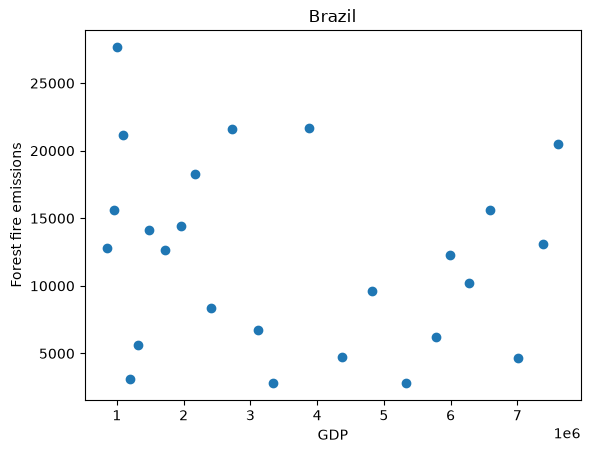
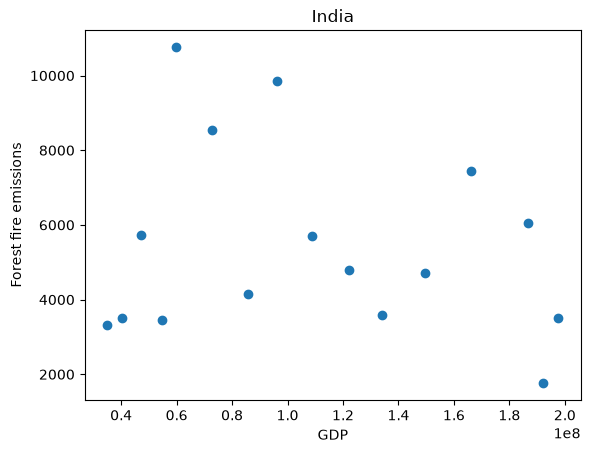
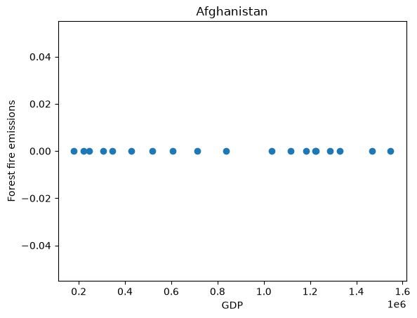
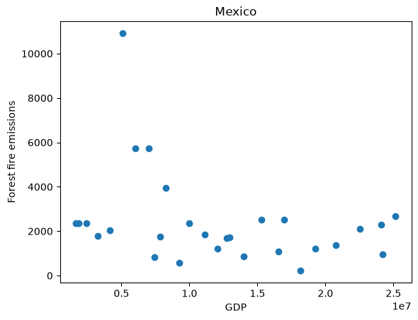
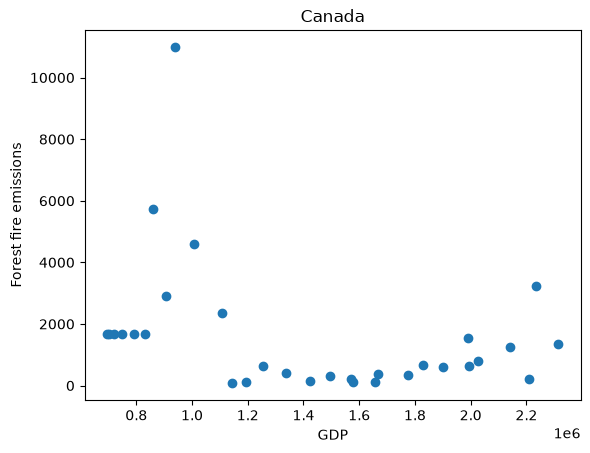

# tdd

This project examines the relationship between forest fire emissions and gross domestic product (GDP) using Python and Snakemake.

## Introduction

This analysis examines the relationship between forest fire emissions and GDP for Brazil, India, Afghanistan, Mexico, and Canada.

Each country is analyzed separately because GDP is reported in each country's local currency and values are therefore not directly comparable across countries.

The original analysis included Brazil, India, and Afghanistan. The analysis was expanded to include Mexico and Canada using a Snakemake workflow.

## Data Setup

Download the full datasets into the top-level `data/` directory. These files are not committed to the repository.

```bash
mkdir -p data

curl -L "https://docs.google.com/uc?export=download&id=1AsXP_OGs1O_TDeXiZjk3fYV1SrG4vwXF" -o data/Agrofood_co2_emission.csv

curl -L "https://docs.google.com/uc?export=download&id=19YEPysdnK7VCXuAe9Og9pwYkNT5CbQzr" -o data/IMF_GDP.csv
```

## Results

### Brazil

Forest fire emissions and GDP for Brazil were highly variable across the observed GDP range, with no clear linear relationship between GDP and forest fire emissions.



### India

Forest fire emissions and GDP for India were also highly variable across the observed GDP range, with no clear linear relationship between GDP and forest fire emissions.



### Afghanistan

Forest fire emissions were approximately zero across the observed GDP range in Afghanistan, with little to no variation across the available years.



### Mexico

Scatterplot comparing forest fire emissions and GDP for Mexico.



### Canada

Scatterplot comparing forest fire emissions and GDP for Canada.



## Methods

Forest fire emissions and GDP data were combined by country and year.

The CO₂ dataset contains one row per country per year, while the GDP dataset contains one row per country with years stored across columns.

The functions in `src/fire_gdp.py` were used to read and combine the datasets:

- `get_data()` reads the files and selects rows for a specific country.
- `get_column_index()` identifies the Forest fires column and matching year in the GDP dataset.
- `get_fire_gdp_year_data()` matches forest fire emissions and GDP values by year.

Years with missing forest fire emissions or GDP values were excluded.

Scatterplots were generated using `src/plot_fire_gdp.py`, with GDP on the x-axis and forest fire emissions on the y-axis.

Countries were analyzed separately because GDP is reported in each country's local currency and is not directly comparable between countries.

## Snakemake Workflow

The analysis was automated using Snakemake, with the workflow defined in `Snakefile`.

Previously, the plotting script was executed manually for each country. Snakemake allows the same script to be executed across multiple countries through a single workflow.

The workflow uses:

- **Variables:** A list specifying which countries to analyze.
- **Wildcards:** `{country}` allows the same rule to generate different country-specific plots.
- **`expand()`:** Generates the expected output filenames for all countries.
- **Rules:** Define required inputs, expected outputs, and commands used to generate results.
- **Dependencies:** Allow Snakemake to identify which outputs need to be created or updated.

### Running the Workflow

Preview the workflow without running commands:

```bash
snakemake -n
```

Generate the plots:

```bash
snakemake --cores 1
```

All figures are saved in the `results/` directory.

Snakemake checks whether the requested output files are present and up to date. If a plot is missing or requires regeneration, Snakemake schedules the necessary job rather than automatically rerunning every plot.

### Ideas for Testing the Workflow

The project already includes Python unit and functional tests. Additional testing could evaluate the behavior of the Snakemake workflow as a whole.

1. **Dry-run testing:** Run `snakemake -n` to confirm that expected jobs and dependencies are identified without executing the workflow.

2. **Output validation:** Verify that each requested country produces a valid, nonempty PNG file containing the expected scatterplot.

3. **Incremental execution testing:** Run the workflow twice and confirm that the second execution does not unnecessarily regenerate outputs.

4. **Missing-output testing:** Remove an output PNG in a test environment and confirm that Snakemake regenerates the missing plot without rerunning unrelated jobs.

5. **Input-change testing:** Modify a copy of an input dataset and verify that dependent outputs are scheduled for regeneration.

6. **Failure testing:** Provide missing or invalid input files in a test environment and confirm that the workflow reports an appropriate error.

These approaches would help evaluate reproducibility, dependency tracking, error handling, and the reliability of the workflow.

## Python Tests

The existing Python tests can be run using:

```bash
pytest -q
```

Python style can be checked using:

```bash
pycodestyle src test
```